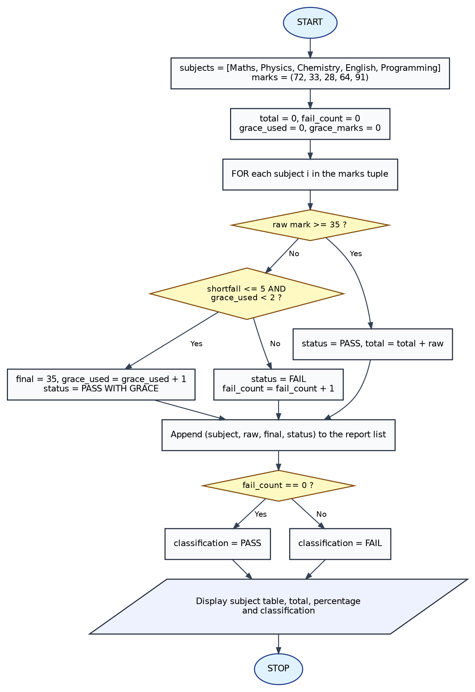
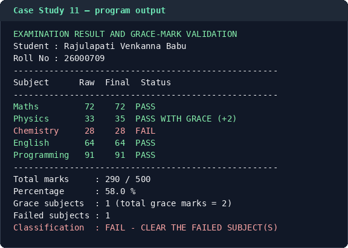

# Case Study 11: Examination Result and Grace-Mark Validation

**Name:** Rajulapati Venkanna Babu  
**Roll No:** 26000709  
**Section:** Section - 4

---

## Problem Statement

A college wants to prepare the result of a student who has written five subjects. Every subject has a maximum of 100 marks and the pass mark is 35. The college has a grace-mark policy as well: a student who is short of the pass mark by up to 5 marks can be given grace marks, but grace can be applied to a maximum of two subjects only. The program must process the marks, apply the pass rule and the grace rule, and print the final classification without ever exceeding the maximum mark of a subject.

## Objectives

- To store the subject names in a list and the marks in a tuple.
- To apply the subject-wise pass criteria using conditional statements.
- To apply the grace-mark policy with its limit of 5 marks and 2 subjects.
- To calculate the total, the percentage and the final classification.
- To display a clear subject-wise result table.

## Assumptions

- Every subject carries a maximum of 100 marks and the pass mark is 35.
- Grace marks are given only when the shortfall is 5 marks or less.
- Grace is applied to at most two subjects.
- The marks are already entered in the program, so no input is needed.
- The percentage is calculated on the final marks after grace.

## Algorithm

1. Start the program.
2. Store the subject names in a list and the five marks in a tuple.
3. Initialise total, fail count, grace count and grace marks to zero and create an empty report list.
4. Repeat for every subject in the list:
   - If the mark is below 0 or above 100, mark it as invalid and count it as a failure.
   - Otherwise, if the mark is 35 or more, keep it as it is and add it to the total.
   - Otherwise, calculate the shortfall.
   - If the shortfall is 5 or less and grace has been used in fewer than two subjects, raise the mark to 35, increase the grace count and the grace marks.
   - Otherwise keep the mark unchanged and count it as a failure.
   - Add the tuple (subject, raw mark, final mark, status) to the report list.
5. Display the subject table by unpacking every tuple of the report list.
6. Calculate the percentage as total divided by the number of subjects.
7. If there is no failure and no grace used, the classification is first class.
8. If there is no failure but grace was used, the classification is pass with grace marks.
9. Otherwise the classification is fail.
10. Display the total, percentage, grace details and classification.
11. Stop the program.

## Flowchart



## Pseudocode

```
SET PASS_MARK = 35
SET MAX_MARK = 100
SET GRACE_LIMIT = 5
SET MAX_GRACE_SUBJECTS = 2

subjects <- ["Maths", "Physics", "Chemistry", "English", "Programming"]
marks <- (72, 33, 28, 64, 91)

total <- 0
fail_count <- 0
grace_used <- 0
grace_marks <- 0
report <- []

FOR i <- 0 TO len(subjects) - 1
    subject <- subjects[i]
    raw <- marks[i]

    IF raw < 0 OR raw > MAX_MARK THEN
        final <- 0
        status <- "INVALID MARK"
        fail_count <- fail_count + 1
    ELSE IF raw >= PASS_MARK THEN
        final <- raw
        status <- "PASS"
        total <- total + final
    ELSE
        shortfall <- PASS_MARK - raw
        IF shortfall <= GRACE_LIMIT AND grace_used < MAX_GRACE_SUBJECTS THEN
            final <- PASS_MARK
            grace_used <- grace_used + 1
            grace_marks <- grace_marks + shortfall
            status <- "PASS WITH GRACE"
            total <- total + final
        ELSE
            final <- raw
            status <- "FAIL"
            fail_count <- fail_count + 1
            total <- total + final
        END IF
    END IF

    APPEND (subject, raw, final, status) TO report
END FOR

DISPLAY the table header
FOR EACH (subject, raw, final, status) IN report
    DISPLAY subject, raw, final, status
END FOR

percentage <- ROUND(total / len(subjects), 2)

IF fail_count = 0 AND grace_used = 0 THEN
    classification <- "FIRST CLASS - NO GRACE NEEDED"
ELSE IF fail_count = 0 THEN
    classification <- "PASS - GRACE MARKS APPLIED"
ELSE
    classification <- "FAIL - CLEAR THE FAILED SUBJECT(S)"
END IF

DISPLAY total, percentage, grace_used, grace_marks, fail_count, classification
```

## Python Source Code

The complete program is in `solution.py`.

```python
# Case Study 11: Examination Result and Grace-Mark Validation
# Syllabus used: variables, operators, conditional statements, loops, strings, lists, tuples

PASS_MARK = 35
MAX_MARK = 100
GRACE_LIMIT = 5          # maximum grace marks that can be given in one subject
MAX_GRACE_SUBJECTS = 2   # maximum number of subjects that can receive grace

subjects = ["Maths", "Physics", "Chemistry", "English", "Programming"]
marks = (72, 33, 28, 64, 91)      # raw marks of one student stored in a tuple

print("EXAMINATION RESULT AND GRACE-MARK VALIDATION")
print("Student : Rajulapati Venkanna Babu")
print("Roll No : 26000709")
print("-" * 52)

fail_count = 0
grace_used = 0
grace_marks = 0
total = 0
report = []

for i in range(len(subjects)):
    subject = subjects[i]
    raw = marks[i]

    if raw < 0 or raw > MAX_MARK:
        final = 0
        status = "INVALID MARK"
        fail_count = fail_count + 1
    elif raw >= PASS_MARK:
        final = raw
        status = "PASS"
        total = total + final
    else:
        shortfall = PASS_MARK - raw
        if shortfall <= GRACE_LIMIT and grace_used < MAX_GRACE_SUBJECTS:
            final = PASS_MARK          # grace never pushes a mark above 100
            grace_used = grace_used + 1
            grace_marks = grace_marks + shortfall
            status = "PASS WITH GRACE (+" + str(shortfall) + ")"
            total = total + final
        else:
            final = raw
            status = "FAIL"
            fail_count = fail_count + 1
            total = total + final

    report.append((subject, raw, final, status))

print("Subject      Raw  Final  Status")
print("-" * 52)
for subject, raw, final, status in report:        # tuple unpacking inside for loop
    print(subject.ljust(12), str(raw).rjust(3), str(final).rjust(5), " " + status)
print("-" * 52)

percentage = round(total / len(subjects), 2)

if fail_count == 0 and grace_used == 0:
    classification = "FIRST CLASS - NO GRACE NEEDED"
elif fail_count == 0:
    classification = "PASS - GRACE MARKS APPLIED"
else:
    classification = "FAIL - CLEAR THE FAILED SUBJECT(S)"

print("Total marks     :", total, "/", MAX_MARK * len(subjects))
print("Percentage      :", percentage, "%")
print("Grace subjects  :", str(grace_used) + " (total grace marks = " + str(grace_marks) + ")")
print("Failed subjects :", fail_count)
print("Classification  :", classification)
```

## Test Cases

| # | Test case | Input | Expected output |
|---|-----------|-------|-----------------|
| 1 | All subjects above the pass mark | No input needed | Every subject shows PASS and the classification is FIRST CLASS - NO GRACE NEEDED |
| 2 | One subject short by 2 marks | No input needed | Physics is raised from 33 to 35 and shows PASS WITH GRACE (+2) |
| 3 | Grace limit of 2 subjects | No input needed | Only the first two eligible subjects receive grace, grace_used is printed as 2 |
| 4 | A subject short by more than 5 marks | No input needed | Chemistry with 28 marks stays FAIL and fail_count becomes 1 |
| 5 | Total and percentage check | No input needed | Total is 290 out of 500 and the percentage is 58.0 % |

All of these test cases are checked automatically by running `python test_cases.py`.

## Output Screenshot



The same output is saved as plain text in `output.txt`.

## Conclusion

The program applies the pass criteria and the grace-mark policy correctly. Every subject is checked separately, the grace limit of 5 marks and 2 subjects is respected, and a failed subject is never hidden. The subject-wise table with tuple unpacking makes the result easy to read, and the classification gives the final outcome of the examination.
