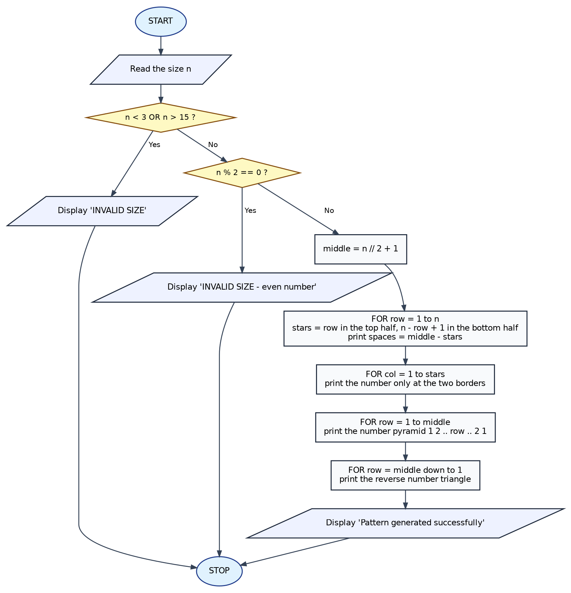
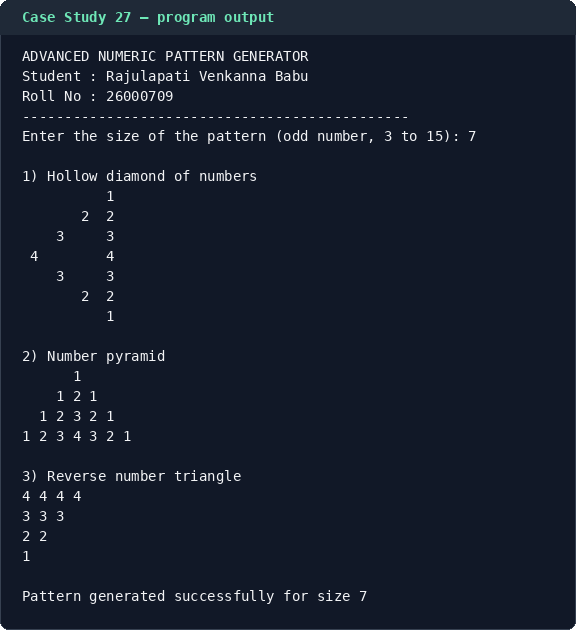

# Case Study 27: Advanced Numeric Pattern Generator

**Name:** Rajulapati Venkanna Babu  
**Roll No:** 26000709  
**Section:** Section - 4

---

## Problem Statement

Pattern printing is used to practise nested loops. The program must ask the user for a size and generate a symmetric numeric pattern of that size. The size has to be an odd number, because an even number cannot be divided into two equal halves for a symmetric diamond. Invalid sizes and even numbers must be rejected with a clear message, and the three generated patterns must be aligned properly.

## Objectives

- To read the size of the pattern from the user.
- To validate the size and reject even or out-of-range values.
- To generate a hollow diamond of numbers using nested loops.
- To generate a number pyramid and a reverse number triangle.
- To keep all the rows aligned by printing the correct number of spaces.

## Assumptions

- The size is an odd number between 3 and 15.
- The pattern is symmetric about its middle row.
- One space is printed after every number so that the columns stay aligned.
- The program prints three pattern variations for the same size.
- No input other than the size is required.

## Algorithm

1. Start the program.
2. Read the size n from the user.
3. If n is less than 3 or greater than 15, display an invalid size message and stop.
4. If n is an even number, display that a symmetric diamond is not possible and stop.
5. Calculate the middle row as n divided by 2 plus 1.
6. For the hollow diamond, repeat for every row from 1 to n:
   - Set the number of stars as the row number for the top half and n minus the row number plus 1 for the bottom half.
   - Print middle minus stars groups of three spaces.
   - Print the star number only at the first and last column of the row and spaces in between.
7. For the pyramid, repeat for every row up to the middle row:
   - Print the leading spaces, then the numbers 1 to row, then the numbers row minus 1 down to 1.
8. For the reverse triangle, repeat for every row from the middle row down to 1 and print the row number that many times.
9. Display a success message.
10. Stop the program.

## Flowchart



## Pseudocode

```
DISPLAY "ADVANCED NUMERIC PATTERN GENERATOR"
READ n

IF n < 3 OR n > 15 THEN
    DISPLAY "INVALID SIZE - the size must be between 3 and 15"
ELSE IF n % 2 = 0 THEN
    DISPLAY "INVALID SIZE - an even number cannot form a symmetric diamond"
ELSE
    middle <- n // 2 + 1

    DISPLAY "1) Hollow diamond of numbers"
    FOR row <- 1 TO n
        IF row <= middle THEN
            stars <- row
        ELSE
            stars <- n - row + 1
        END IF

        line <- ""
        FOR s <- 1 TO middle - stars
            line <- line + "   "
        END FOR
        FOR col <- 1 TO stars
            IF col = 1 OR col = stars THEN
                line <- line + RIGHT_JUSTIFY(stars, 2) + " "
            ELSE
                line <- line + "   "
            END IF
        END FOR
        DISPLAY line
    END FOR

    DISPLAY "2) Number pyramid"
    FOR row <- 1 TO middle
        line <- ""
        FOR s <- 1 TO middle - row
            line <- line + "  "
        END FOR
        FOR col <- 1 TO row
            line <- line + col + " "
        END FOR
        FOR col <- row - 1 DOWN TO 1
            line <- line + col + " "
        END FOR
        DISPLAY line
    END FOR

    DISPLAY "3) Reverse number triangle"
    FOR row <- middle DOWN TO 1
        line <- ""
        FOR col <- 1 TO row
            line <- line + row + " "
        END FOR
        DISPLAY line
    END FOR

    DISPLAY "Pattern generated successfully for size", n
END IF
```

## Python Source Code

The complete program is in `solution.py`.

```python
# Case Study 27: Advanced Numeric Pattern Generator
# Syllabus used: variables, operators, conditional statements, loops, pattern generation

print("ADVANCED NUMERIC PATTERN GENERATOR")
print("Student : Rajulapati Venkanna Babu")
print("Roll No : 26000709")
print("-" * 46)

n = int(input("Enter the size of the pattern (odd number, 3 to 15): "))

if n < 3 or n > 15:
    print("INVALID SIZE - the size must be between 3 and 15")
elif n % 2 == 0:
    print("INVALID SIZE - an even number cannot form a symmetric diamond")
else:
    middle = n // 2 + 1

    print()
    print("1) Hollow diamond of numbers")
    for row in range(1, n + 1):
        if row <= middle:
            stars = row
        else:
            stars = n - row + 1

        line = ""
        spaces = middle - stars
        for s in range(spaces):
            line = line + "   "
        for col in range(1, stars + 1):
            if col == 1 or col == stars:
                line = line + str(stars).rjust(2) + " "
            else:
                line = line + "   "
        print(line)

    print()
    print("2) Number pyramid")
    for row in range(1, middle + 1):
        line = ""
        for s in range(middle - row):
            line = line + "  "
        for col in range(1, row + 1):
            line = line + str(col) + " "
        for col in range(row - 1, 0, -1):
            line = line + str(col) + " "
        print(line)

    print()
    print("3) Reverse number triangle")
    for row in range(middle, 0, -1):
        line = ""
        for col in range(1, row + 1):
            line = line + str(row) + " "
        print(line)

    print()
    print("Pattern generated successfully for size", n)
```

## Test Cases

| # | Test case | Input | Expected output |
|---|-----------|-------|-----------------|
| 1 | Valid odd size 7 | 7 | All three patterns are printed and the size 7 diamond is symmetric |
| 2 | Smallest valid size 3 | 3 | A small diamond, pyramid and triangle are printed |
| 3 | Even size 6 | 6 | INVALID SIZE - an even number cannot form a symmetric diamond |
| 4 | Size below the limit | 2 | INVALID SIZE - the size must be between 3 and 15 |
| 5 | Size above the limit | 21 | INVALID SIZE - the size must be between 3 and 15 |

All of these test cases are checked automatically by running `python test_cases.py`.

## Output Screenshot



The same output is saved as plain text in `output.txt`.

## Conclusion

The program generates a symmetric numeric pattern only for a valid odd size and clearly rejects every invalid input. Nested loops with an inner spacing loop keep the output aligned, and the three patterns show how the same size value can be used with different loop directions.
