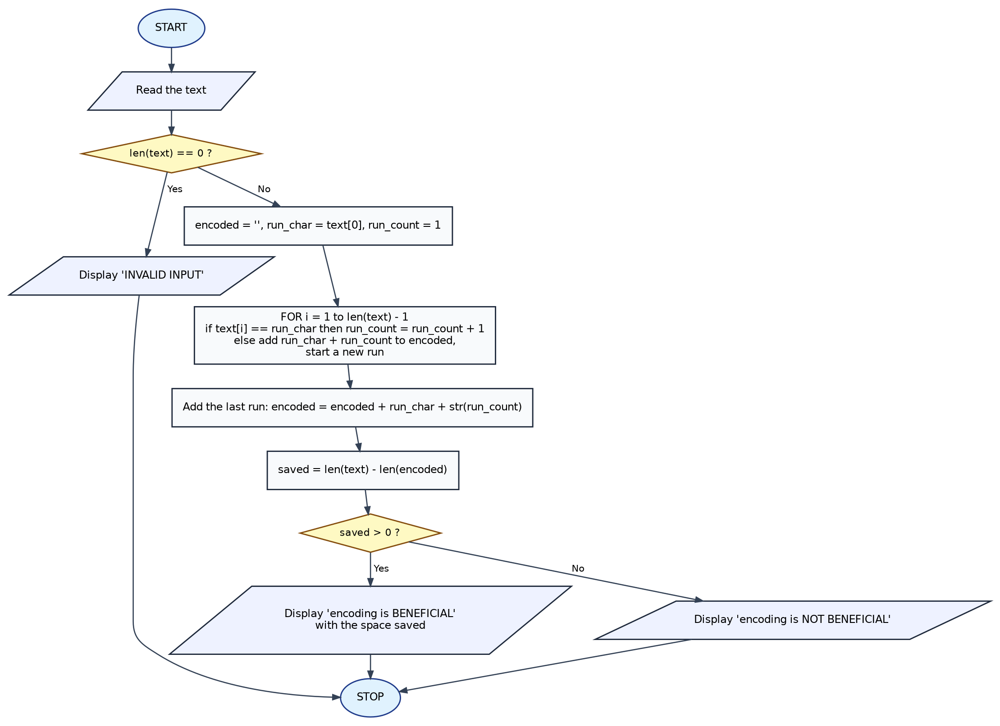
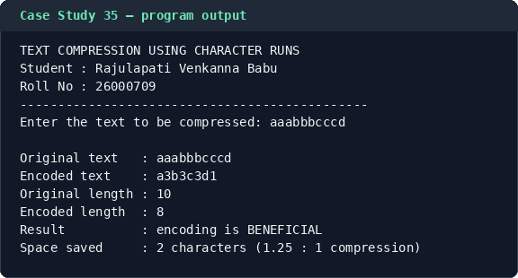

# Case Study 35: Text Compression Using Character Runs

**Name:** Rajulapati Venkanna Babu  
**Roll No:** 26000709  
**Section:** Section - 4

---

## Problem Statement

A simple compression method replaces every group of consecutive repeated characters with the character followed by the number of repetitions. For example the text aaabbbcccd becomes a3b3c3d1. The program must encode the text using this method, print the original and encoded lengths, and report whether the encoding actually reduces the size of the text.

## Objectives

- To read a text string from the user.
- To find the runs of consecutive repeated characters using a loop.
- To build the encoded string with the character and its count.
- To compare the original and the encoded length.
- To report whether the compression is beneficial, neutral or not useful.

## Assumptions

- The text contains only the characters typed by the user.
- Upper case and lower case letters are treated as different characters.
- Every run is written as one character followed by its count, even when the count is 1.
- The text is not empty, because an empty string has nothing to encode.
- The comparison is done only on the length, not on the file size.

## Algorithm

1. Start the program.
2. Read the text from the user.
3. If the text is empty, display an invalid input message and stop.
4. Take the first character as the current run character and set the run count to 1.
5. Repeat for every character from the second position to the end:
   - If the character is the same as the run character, increase the run count by one.
   - Otherwise, add the run character and the run count to the encoded string, set the new run character to this character and reset the run count to 1.
6. After the loop, add the last run to the encoded string.
7. Display the original text, the encoded text and both lengths.
8. Calculate the number of characters saved.
9. If the saved count is positive, report that the encoding is beneficial and print the compression ratio.
10. If the saved count is zero, report that the encoding is neutral.
11. Otherwise report that the encoding is not beneficial.
12. Stop the program.

## Flowchart



## Pseudocode

```
DISPLAY "TEXT COMPRESSION USING CHARACTER RUNS"
READ text

IF len(text) = 0 THEN
    DISPLAY "INVALID INPUT - the text is empty"
ELSE
    encoded <- ""
    run_char <- text[0]
    run_count <- 1

    FOR i <- 1 TO len(text) - 1
        IF text[i] = run_char THEN
            run_count <- run_count + 1
        ELSE
            encoded <- encoded + run_char + TO_STRING(run_count)
            run_char <- text[i]
            run_count <- 1
        END IF
    END FOR

    encoded <- encoded + run_char + TO_STRING(run_count)

    DISPLAY "Original text   :", text
    DISPLAY "Encoded text    :", encoded
    DISPLAY "Original length :", len(text)
    DISPLAY "Encoded length  :", len(encoded)

    saved <- len(text) - len(encoded)

    IF saved > 0 THEN
        ratio <- ROUND(len(text) / len(encoded), 2)
        DISPLAY "Result          : encoding is BENEFICIAL"
        DISPLAY "Space saved     :", saved, "characters (" + ratio + " : 1 compression)"
    ELSE IF saved = 0 THEN
        DISPLAY "Result          : encoding is NEUTRAL - same length as the original"
    ELSE
        DISPLAY "Result          : encoding is NOT BENEFICIAL - original text is shorter"
    END IF
END IF
```

## Python Source Code

The complete program is in `solution.py`.

```python
# Case Study 35: Text Compression Using Character Runs
# Syllabus used: variables, operators, conditional statements, loops, strings

print("TEXT COMPRESSION USING CHARACTER RUNS")
print("Student : Rajulapati Venkanna Babu")
print("Roll No : 26000709")
print("-" * 46)

text = input("Enter the text to be compressed: ")

if len(text) == 0:
    print("INVALID INPUT - the text is empty")
else:
    encoded = ""
    run_char = text[0]
    run_count = 1

    for i in range(1, len(text)):
        if text[i] == run_char:
            run_count = run_count + 1
        else:
            encoded = encoded + run_char + str(run_count)
            run_char = text[i]
            run_count = 1
    encoded = encoded + run_char + str(run_count)     # last run is added after the loop

    print()
    print("Original text   :", text)
    print("Encoded text    :", encoded)
    print("Original length :", len(text))
    print("Encoded length  :", len(encoded))

    saved = len(text) - len(encoded)
    if saved > 0:
        ratio = round(len(text) / len(encoded), 2)
        print("Result          : encoding is BENEFICIAL")
        print("Space saved     :", saved, "characters (" + str(ratio) + " : 1 compression)")
    elif saved == 0:
        print("Result          : encoding is NEUTRAL - same length as the original")
    else:
        print("Result          : encoding is NOT BENEFICIAL - original text is shorter")
```

## Test Cases

| # | Test case | Input | Expected output |
|---|-----------|-------|-----------------|
| 1 | Text with repeated runs | aaabbbcccd | Encoded text is a3b3c3d1 and the result is BENEFICIAL |
| 2 | Single long run | aaaaa | Encoded text is a5 with 3 characters saved |
| 3 | No repetition at all | abcde | Encoded text is a1b1c1d1e1 and the result is NOT BENEFICIAL |
| 4 | Different case letters | aAbB | Encoded text is a1A1b1B1, so case is not ignored |
| 5 | Empty text | (blank line) | INVALID INPUT - the text is empty |

All of these test cases are checked automatically by running `python test_cases.py`.

## Output Screenshot



The same output is saved as plain text in `output.txt`.

## Conclusion

The run-length encoding works correctly for repeated and non-repeated text. The program also shows an honest result, because it reports that the encoding is not useful when the text has few repetitions, which is an important part of the problem.
