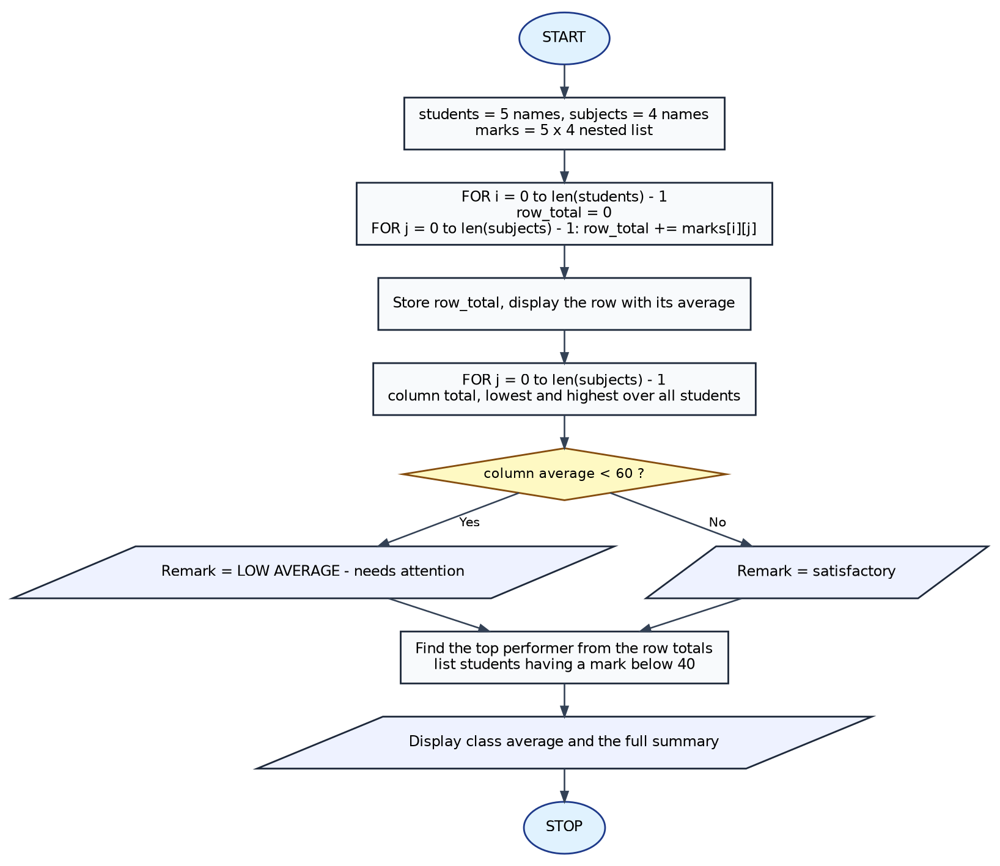
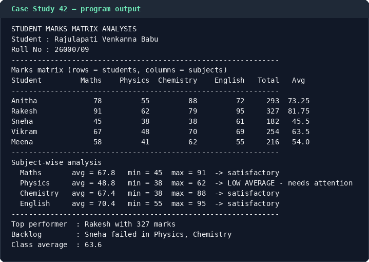

# Case Study 42: Student Marks Matrix Analysis

**Name:** Rajulapati Venkanna Babu  
**Roll No:** 26000709  
**Section:** Section - 4

---

## Problem Statement

A class teacher has the marks of five students in four subjects. The marks are kept in a nested list, where every inner list holds the marks of one student. The program must calculate the total and average of every student, the average, minimum and maximum of every subject, find the top performer, list the students who have failed a subject, and print the average of the whole class.

## Objectives

- To store the marks of many students using a nested list.
- To calculate row-wise statistics (student totals and averages).
- To calculate column-wise statistics (subject average, minimum and maximum).
- To identify the top performer and the students with a backlog.
- To print the results in a neat table.

## Assumptions

- Every student has marks in the same four subjects and in the same order.
- The maximum mark in a subject is 100 and the pass mark is 40.
- A subject whose class average is below 60 is reported as a low average subject.
- The number of students and subjects is fixed inside the program.
- No marks are missing for any student.

## Algorithm

1. Start the program.
2. Store the student names in a list, the subject names in a list and the marks in a nested list.
3. Create an empty list for the row totals.
4. Repeat for every student:
   - Set the row total to zero and add every mark of that student.
   - Store the row total in the totals list.
   - Print the name, all marks, the total and the average.
5. Repeat for every subject:
   - Find the column total, the lowest mark and the highest mark over all students.
   - Calculate the subject average.
   - If the average is below 60, print a low average remark, otherwise print satisfactory.
6. Find the student with the highest total and print the top performer.
7. For every student, collect the names of the subjects in which the mark is below 40 and print them.
8. Add all the row totals and print the class average.
9. Stop the program.

## Flowchart



## Pseudocode

```
DISPLAY "STUDENT MARKS MATRIX ANALYSIS"

students <- ["Anitha", "Rakesh", "Sneha", "Vikram", "Meena"]
subjects <- ["Maths", "Physics", "Chemistry", "English"]
marks <- [[78, 55, 88, 72],
          [91, 62, 79, 95],
          [45, 38, 38, 61],
          [67, 48, 70, 69],
          [58, 41, 62, 55]]
PASS_MARK <- 40

row_totals <- []

FOR i <- 0 TO len(students) - 1
    row_total <- 0
    FOR j <- 0 TO len(subjects) - 1
        row_total <- row_total + marks[i][j]
    END FOR
    APPEND row_total TO row_totals
    DISPLAY students[i], all marks of row i, row_total, ROUND(row_total / len(subjects), 2)
END FOR

FOR j <- 0 TO len(subjects) - 1
    column_total <- 0
    lowest <- marks[0][j]
    highest <- marks[0][j]
    FOR i <- 0 TO len(marks) - 1
        column_total <- column_total + marks[i][j]
        IF marks[i][j] < lowest THEN lowest <- marks[i][j]
        IF marks[i][j] > highest THEN highest <- marks[i][j]
    END FOR
    average <- ROUND(column_total / len(students), 2)
    IF average < 60 THEN
        DISPLAY subjects[j], "LOW AVERAGE - needs attention"
    ELSE
        DISPLAY subjects[j], "satisfactory"
    END IF
END FOR

top_index <- 0
FOR i <- 1 TO len(students) - 1
    IF row_totals[i] > row_totals[top_index] THEN top_index <- i
END FOR
DISPLAY "Top performer :", students[top_index], row_totals[top_index]

FOR i <- 0 TO len(students) - 1
    failed <- ""
    FOR j <- 0 TO len(subjects) - 1
        IF marks[i][j] < PASS_MARK THEN failed <- failed + subjects[j]
    END FOR
    IF failed <> "" THEN DISPLAY students[i], "failed in", failed
END FOR

class_total <- 0
FOR EACH total IN row_totals
    class_total <- class_total + total
END FOR
DISPLAY "Class average :", ROUND(class_total / (len(students) * len(subjects)), 2)
```

## Python Source Code

The complete program is in `solution.py`.

```python
# Case Study 42: Student Marks Matrix Analysis
# Syllabus used: variables, operators, conditional statements, loops, strings, lists, nested lists

print("STUDENT MARKS MATRIX ANALYSIS")
print("Student : Rajulapati Venkanna Babu")
print("Roll No : 26000709")
print("-" * 62)

students = ["Anitha", "Rakesh", "Sneha", "Vikram", "Meena"]
subjects = ["Maths", "Physics", "Chemistry", "English"]

# nested list - one inner list of marks for each student
marks = [
    [78, 55, 88, 72],
    [91, 62, 79, 95],
    [45, 38, 38, 61],
    [67, 48, 70, 69],
    [58, 41, 62, 55],
]
PASS_MARK = 40

print("Marks matrix (rows = students, columns = subjects)")
header = "Student".ljust(10)
for subject in subjects:
    header = header + subject.rjust(11)
header = header + "   Total   Avg"
print(header)
print("-" * 62)

row_totals = []
for i in range(len(students)):
    row_total = 0
    for j in range(len(subjects)):
        row_total = row_total + marks[i][j]
    row_totals.append(row_total)

    line = students[i].ljust(10)
    for j in range(len(subjects)):
        line = line + str(marks[i][j]).rjust(11)
    line = line + str(row_total).rjust(8)
    line = line + str(round(row_total / len(subjects), 2)).rjust(7)
    print(line)

print("-" * 62)

# column-wise (subject-wise) statistics
print("Subject-wise analysis")
for j in range(len(subjects)):
    column_total = 0
    lowest = marks[0][j]
    highest = marks[0][j]
    for i in range(len(marks)):
        column_total = column_total + marks[i][j]
        if marks[i][j] < lowest:
            lowest = marks[i][j]
        if marks[i][j] > highest:
            highest = marks[i][j]
    average = round(column_total / len(students), 2)
    if average < 60:
        remark = "LOW AVERAGE - needs attention"
    else:
        remark = "satisfactory"
    print(" ", subjects[j].ljust(11), "avg =", str(average).ljust(6),
          "min =", str(lowest).ljust(3), "max =", str(highest).ljust(3), "->", remark)

print("-" * 62)

# top performer
top_index = 0
for i in range(1, len(students)):
    if row_totals[i] > row_totals[top_index]:
        top_index = i
print("Top performer  :", students[top_index], "with", row_totals[top_index], "marks")

# students with a failed subject
for i in range(len(students)):
    failed = ""
    for j in range(len(subjects)):
        if marks[i][j] < PASS_MARK:
            if failed != "":
                failed = failed + ", "
            failed = failed + subjects[j]
    if failed != "":
        print("Backlog        :", students[i], "failed in", failed)

# overall class average
class_total = 0
for total in row_totals:
    class_total = class_total + total
print("Class average  :", round(class_total / (len(students) * len(subjects)), 2))
```

## Test Cases

| # | Test case | Input | Expected output |
|---|-----------|-------|-----------------|
| 1 | Student totals | No input needed | Anitha shows a total of 293 and an average of 73.25 |
| 2 | Subject wise statistics | No input needed | Physics shows average 48.8, minimum 38, maximum 62 and a low average remark |
| 3 | Top performer | No input needed | Top performer is Rakesh with 327 marks |
| 4 | Students with a backlog | No input needed | Sneha is reported for Physics and Chemistry |
| 5 | Class average | No input needed | The class average is 63.6 |

All of these test cases are checked automatically by running `python test_cases.py`.

## Output Screenshot



The same output is saved as plain text in `output.txt`.

## Conclusion

The nested list keeps the marks of a whole class in one structure. Traversing it row-wise gives the student-wise result and traversing it column-wise gives the subject-wise result, so a single matrix supports both kinds of analysis without repeating the data.
