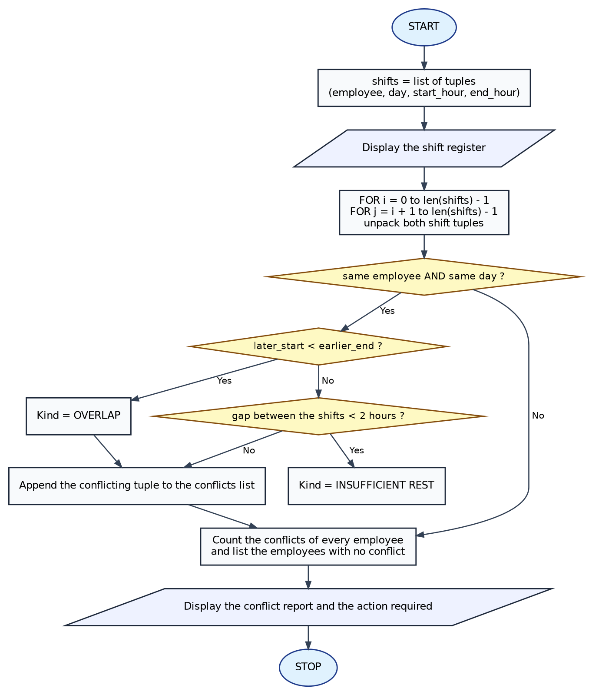
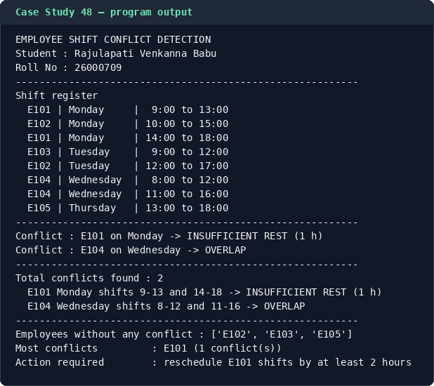

# Case Study 48: Tuple-Based Employee Shift Conflict Detection

**Name:** Rajulapati Venkanna Babu  
**Roll No:** 26000709  
**Section:** Section - 4

---

## Problem Statement

A company stores the duty shifts of its employees as tuples of the form (employee, day, start hour, end hour). Two shifts of the same employee on the same day are a problem when they overlap, and they are also a problem when the rest gap between them is less than two hours. The program must compare all the shifts, print the conflict report, list the employees who have no conflict, and identify the employee with the most conflicts.

## Objectives

- To store the shifts as a list of tuples.
- To read the shift details using tuple unpacking.
- To compare every pair of shifts of the same employee on the same day.
- To classify each pair as overlap, insufficient rest or safe.
- To prepare a conflict report and suggest corrective action.

## Assumptions

- The hours are given in the 24-hour format and every shift ends on the same day.
- A pair of shifts is compared only when both belong to the same employee and the same day.
- The minimum rest gap between two shifts of the same day is 2 hours.
- Touching shifts with a gap of 2 hours or more are treated as safe.
- The shift list is already available in the program.

## Algorithm

1. Start the program.
2. Store all the shifts as tuples in a list.
3. Display the shift register by unpacking every tuple.
4. Create an empty conflicts list and set the minimum rest gap to 2 hours.
5. Repeat for every pair of shifts using two nested loops:
   - Unpack both shift tuples.
   - If the employee and the day are the same, find which shift ends first.
   - If the later shift starts before the earlier shift ends, the pair is an overlap.
   - Otherwise, if the gap is less than 2 hours, the pair has insufficient rest.
   - If the pair is not safe, add a conflict tuple to the conflicts list and print it.
6. If there are no conflicts, print that the schedule is clean.
7. Otherwise print the number of conflicts and the full conflict report.
8. List the employees who do not appear in any conflict.
9. Count the conflicts of every employee and print the employee with the most conflicts and the action required.
10. Stop the program.

## Flowchart



## Pseudocode

```
DISPLAY "EMPLOYEE SHIFT CONFLICT DETECTION"
shifts <- [("E101", "Monday", 9, 13), ("E102", "Monday", 10, 15),
           ("E101", "Monday", 14, 18), ("E103", "Tuesday", 9, 12),
           ("E102", "Tuesday", 12, 17), ("E104", "Wednesday", 8, 12),
           ("E104", "Wednesday", 11, 16), ("E105", "Thursday", 13, 18)]
MIN_GAP <- 2
conflicts <- []

FOR EACH shift IN shifts
    (employee, day, start, end) <- shift
    DISPLAY employee, day, start, end
END FOR

FOR i <- 0 TO len(shifts) - 1
    FOR j <- i + 1 TO len(shifts) - 1
        (emp1, day1, start1, end1) <- shifts[i]
        (emp2, day2, start2, end2) <- shifts[j]

        IF emp1 = emp2 AND day1 = day2 THEN
            IF start1 <= start2 THEN
                earlier_end <- end1
                later_start <- start2
            ELSE
                earlier_end <- end2
                later_start <- start1
            END IF

            IF later_start < earlier_end THEN
                kind <- "OVERLAP"
            ELSE IF later_start - earlier_end < MIN_GAP THEN
                kind <- "INSUFFICIENT REST"
            ELSE
                kind <- "OK"
            END IF

            IF kind <> "OK" THEN
                APPEND (emp1, day1, start1, end1, start2, end2, kind) TO conflicts
            END IF
        END IF
    END FOR
END FOR

DISPLAY "Total conflicts found :", len(conflicts)
FOR EACH conflict IN conflicts
    (employee, day, start1, end1, start2, end2, kind) <- conflict
    DISPLAY employee, day, start1, end1, start2, end2, kind
END FOR

clean <- []
FOR EACH shift IN shifts
    found <- FALSE
    FOR EACH conflict IN conflicts
        IF conflict[0] = shift[0] THEN found <- TRUE
    END FOR
    IF found = FALSE AND shift[0] NOT IN clean THEN APPEND shift[0] TO clean
END FOR
DISPLAY "Employees without any conflict :", clean
```

## Python Source Code

The complete program is in `solution.py`.

```python
# Case Study 48: Tuple-Based Employee Shift Conflict Detection
# Syllabus used: variables, operators, conditional statements, loops, strings, lists, tuples,
#               tuple operations and unpacking

print("EMPLOYEE SHIFT CONFLICT DETECTION")
print("Student : Rajulapati Venkanna Babu")
print("Roll No : 26000709")
print("-" * 58)

# each shift is a tuple: (employee, day, start_hour, end_hour)
shifts = [
    ("E101", "Monday", 9, 13),
    ("E102", "Monday", 10, 15),
    ("E101", "Monday", 14, 18),
    ("E103", "Tuesday", 9, 12),
    ("E102", "Tuesday", 12, 17),
    ("E104", "Wednesday", 8, 12),
    ("E104", "Wednesday", 11, 16),
    ("E105", "Thursday", 13, 18),
]

print("Shift register")
for employee, day, start, end in shifts:          # tuple unpacking
    print("  " + employee, "|", day.ljust(10), "|", str(start).rjust(2) + ":00 to", str(end).rjust(2) + ":00")
print("-" * 58)

MIN_GAP = 2          # minimum rest hours allowed between two shifts of the same employee
conflicts = []

for i in range(len(shifts)):
    for j in range(i + 1, len(shifts)):
        emp1, day1, start1, end1 = shifts[i]
        emp2, day2, start2, end2 = shifts[j]

        if emp1 == emp2 and day1 == day2:
            if start1 <= start2:
                earlier_end = end1
                later_start = start2
            else:
                earlier_end = end2
                later_start = start1

            if later_start < earlier_end:
                kind = "OVERLAP"
            elif later_start - earlier_end < MIN_GAP:
                kind = "INSUFFICIENT REST (" + str(later_start - earlier_end) + " h)"
            else:
                kind = "OK"

            if kind != "OK":
                conflicts.append((emp1, day1, start1, end1, start2, end2, kind))
                print("Conflict :", emp1, "on", day1, "->", kind)

print("-" * 58)

if len(conflicts) == 0:
    print("Result : no scheduling conflicts found")
else:
    print("Total conflicts found :", len(conflicts))
    for employee, day, start1, end1, start2, end2, kind in conflicts:      # tuple unpacking
        print("  " + employee, day, "shifts", str(start1) + "-" + str(end1),
              "and", str(start2) + "-" + str(end2), "->", kind)

# employees whose schedule is clean
clean = []
for employee, day, start, end in shifts:
    found = False
    for conflict in conflicts:
        if conflict[0] == employee:
            found = True
    if found == False:
        if employee not in clean:
            clean.append(employee)

print("-" * 58)
print("Employees without any conflict :", clean)

# which employee has the most conflicts
worst_employee = ""
worst_count = 0
checked = []
for conflict in conflicts:
    employee = conflict[0]
    if employee not in checked:
        checked.append(employee)
        count = 0
        for other in conflicts:
            if other[0] == employee:
                count = count + 1
        if count > worst_count:
            worst_count = count
            worst_employee = employee

if worst_employee != "":
    print("Most conflicts         :", worst_employee, "(" + str(worst_count) + " conflict(s))")
    print("Action required        : reschedule", worst_employee, "shifts by at least", MIN_GAP, "hours")
```

## Test Cases

| # | Test case | Input | Expected output |
|---|-----------|-------|-----------------|
| 1 | Overlapping shifts are detected | No input needed | E104 on Wednesday is reported as OVERLAP |
| 2 | Small rest gap is detected | No input needed | E101 on Monday is reported as INSUFFICIENT REST (1 h) |
| 3 | Number of conflicts | No input needed | Total conflicts found is 2 |
| 4 | Employees with a clean schedule | No input needed | E102, E103 and E105 are listed as having no conflict |
| 5 | Worst affected employee | No input needed | E101 is reported with the action to reschedule by 2 hours |

All of these test cases are checked automatically by running `python test_cases.py`.

## Output Screenshot



The same output is saved as plain text in `output.txt`.

## Conclusion

Storing the shifts as tuples keeps each record together and tuple unpacking makes the comparison short and readable. The program finds both overlapping shifts and shifts with too little rest, which a simple overlap check alone would miss.
