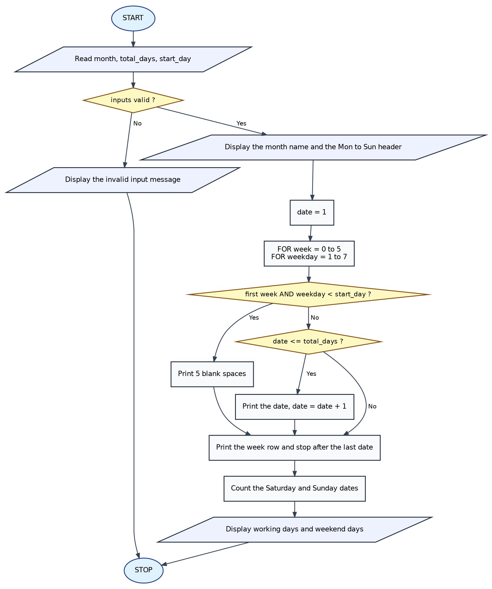
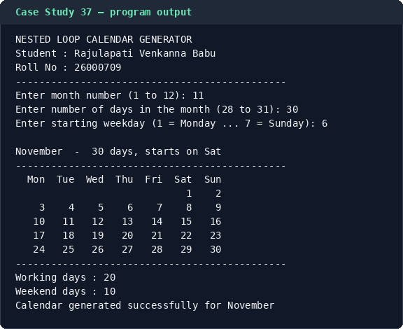

# Case Study 37: Nested Loop Calendar Generator

**Name:** Rajulapati Venkanna Babu  
**Roll No:** 26000709  
**Section:** Section - 4

---

## Problem Statement

A calendar for a month can be printed when the starting weekday and the number of days in the month are known. The program must read the month number, the number of days and the starting weekday, validate all three values, and print the dates in a proper week-wise layout under the Monday to Sunday headings. It must also count the working days and the weekend days of that month.

## Objectives

- To read the month number, number of days and starting weekday from the user.
- To validate all three inputs before printing anything.
- To generate the calendar using nested loops, one loop for the weeks and one for the weekdays.
- To leave the correct number of blank cells before the first date.
- To count and display the working days and the weekend days.

## Assumptions

- The weekday is entered as 1 for Monday up to 7 for Sunday.
- A month has between 28 and 31 days.
- The month always fits in at most six weeks, so six week rows are enough.
- Saturday and Sunday are the weekend days.
- No leap year calculation is needed because the number of days is given by the user.

## Algorithm

1. Start the program.
2. Read the month number, the number of days and the starting weekday.
3. If the month number is not between 1 and 12, display an invalid month message and stop.
4. If the number of days is not between 28 and 31, display an invalid length message and stop.
5. If the starting weekday is not between 1 and 7, display an invalid weekday message and stop.
6. Display the month name and the weekday header.
7. Set the date to 1.
8. Repeat for each of the six possible weeks:
   - Create an empty line.
   - Repeat for each of the seven weekdays:
   - If it is the first week and the weekday is before the starting weekday, add blank spaces.
   - Otherwise, if the date is still within the month, add the date and increase it by one.
   - Otherwise add blank spaces.
   - Print the line when it is not empty and stop when every date has been printed.
9. Count the dates that fall on Saturday or Sunday.
10. Display the working days and the weekend days.
11. Stop the program.

## Flowchart



## Pseudocode

```
DAYS <- ["Mon", "Tue", "Wed", "Thu", "Fri", "Sat", "Sun"]
MONTHS <- ["January", ..., "December"]

READ month, total_days, start_day

IF month < 1 OR month > 12 THEN
    DISPLAY "INVALID MONTH"
ELSE IF total_days < 28 OR total_days > 31 THEN
    DISPLAY "INVALID MONTH LENGTH"
ELSE IF start_day < 1 OR start_day > 7 THEN
    DISPLAY "INVALID WEEKDAY"
ELSE
    DISPLAY MONTHS[month - 1], total_days, DAYS[start_day - 1]

    header <- ""
    FOR EACH day_name IN DAYS
        header <- header + RIGHT_JUSTIFY(day_name, 5)
    END FOR
    DISPLAY header

    date <- 1
    FOR week <- 0 TO 5
        line <- ""
        FOR weekday <- 1 TO 7
            IF week = 0 AND weekday < start_day THEN
                line <- line + "     "
            ELSE IF date <= total_days THEN
                line <- line + RIGHT_JUSTIFY(date, 5)
                date <- date + 1
            ELSE
                line <- line + "     "
            END IF
        END FOR
        IF TRIM(line) <> "" THEN DISPLAY line
        IF date > total_days THEN EXIT LOOP
    END FOR

    weekends <- 0
    FOR date <- 1 TO total_days
        position <- (start_day - 1 + date - 1) % 7
        IF position = 5 OR position = 6 THEN weekends <- weekends + 1
    END FOR

    DISPLAY "Working days :", total_days - weekends
    DISPLAY "Weekend days :", weekends
END IF
```

## Python Source Code

The complete program is in `solution.py`.

```python
# Case Study 37: Nested Loop Calendar Generator
# Syllabus used: variables, operators, conditional statements, loops, strings, pattern generation

DAYS = ["Mon", "Tue", "Wed", "Thu", "Fri", "Sat", "Sun"]
MONTHS = ["January", "February", "March", "April", "May", "June",
          "July", "August", "September", "October", "November", "December"]

print("NESTED LOOP CALENDAR GENERATOR")
print("Student : Rajulapati Venkanna Babu")
print("Roll No : 26000709")
print("-" * 46)

month = int(input("Enter month number (1 to 12): "))
total_days = int(input("Enter number of days in the month (28 to 31): "))
start_day = int(input("Enter starting weekday (1 = Monday ... 7 = Sunday): "))

if month < 1 or month > 12:
    print("INVALID MONTH - please enter a number between 1 and 12")
elif total_days < 28 or total_days > 31:
    print("INVALID MONTH LENGTH - a month can have only 28 to 31 days")
elif start_day < 1 or start_day > 7:
    print("INVALID WEEKDAY - please enter 1 for Monday up to 7 for Sunday")
else:
    print()
    print(MONTHS[month - 1] + "  -  " + str(total_days) + " days, starts on " + DAYS[start_day - 1])
    print("-" * 46)

    header = ""
    for day_name in DAYS:
        header = header + day_name.rjust(5)
    print(header)

    # outer loop = weeks, inner loop = the seven weekdays of a week
    date = 1
    for week in range(6):
        line = ""
        for weekday in range(1, 8):
            if week == 0 and weekday < start_day:
                line = line + "     "          # blank cells before the 1st date
            elif date <= total_days:
                line = line + str(date).rjust(5)
                date = date + 1
            else:
                line = line + "     "
        if line.strip() != "":
            print(line)
        if date > total_days:
            break

    print("-" * 46)

    # weekend count for the month
    weekends = 0
    for date in range(1, total_days + 1):
        position = (start_day - 1 + date - 1) % 7
        if position == 5 or position == 6:
            weekends = weekends + 1

    print("Working days :", total_days - weekends)
    print("Weekend days :", weekends)
    print("Calendar generated successfully for", MONTHS[month - 1])
```

## Test Cases

| # | Test case | Input | Expected output |
|---|-----------|-------|-----------------|
| 1 | November with 30 days starting on Saturday | 11, 30, 6 | The dates are printed from 1 under Sat and the month ends on 30 under Sun |
| 2 | Working day count for this month | 11, 30, 6 | Working days is 20 and weekend days is 10 |
| 3 | January with 31 days starting on Thursday | 1, 31, 4 | Working days is 22 |
| 4 | Invalid month number | 13, 30, 1 | INVALID MONTH - please enter a number between 1 and 12 |
| 5 | Invalid month length | 2, 25, 3 | INVALID MONTH LENGTH - a month can have only 28 to 31 days |
| 6 | Invalid weekday | 5, 31, 9 | INVALID WEEKDAY - please enter 1 for Monday up to 7 for Sunday |

All of these test cases are checked automatically by running `python test_cases.py`.

## Output Screenshot



The same output is saved as plain text in `output.txt`.

## Conclusion

The calendar is generated correctly with the dates placed under the right weekday headings and the blank cells before the first date are handled properly. The nested loops make the week-wise structure clear, and the input validation prevents a meaningless calendar from being printed.
