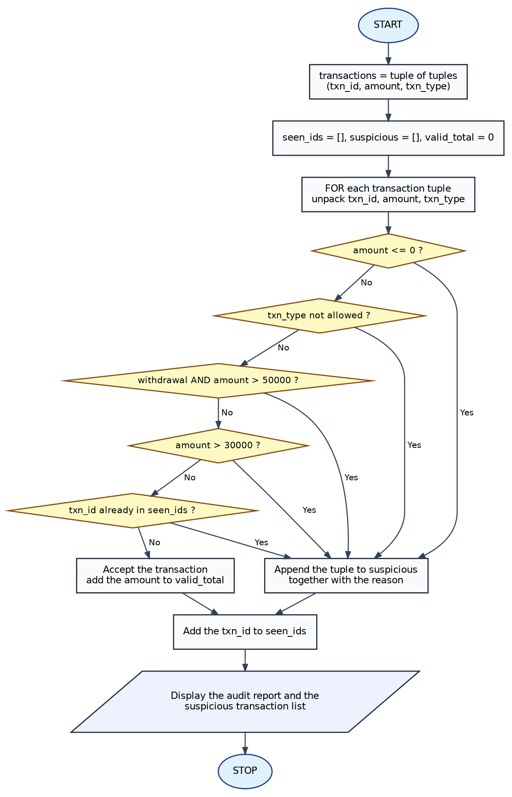
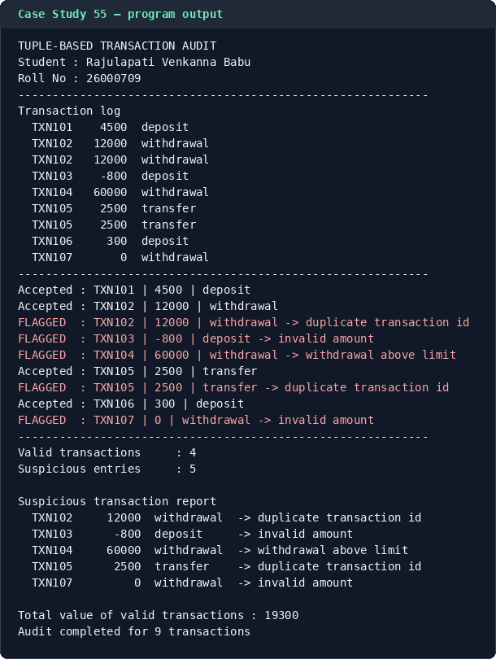

# Case Study 55: Tuple-Based Transaction Audit

**Name:** Rajulapati Venkanna Babu  
**Roll No:** 26000709  
**Section:** Section - 4

---

## Problem Statement

A bank wants a small audit program for a list of transactions. Every transaction is stored as a tuple containing the transaction identifier, the amount and the transaction type. The program must check every transaction for an invalid amount, an unknown transaction type, a withdrawal above the bank limit, a very high value transaction and a repeated transaction identifier, and then produce a report of the suspicious entries.

## Objectives

- To store the transactions as tuples inside a tuple of records.
- To read each record using tuple unpacking.
- To validate the amount, the transaction type and the withdrawal limit.
- To detect duplicate transaction identifiers using a list.
- To print a suspicious transaction report and the total value of the valid transactions.

## Assumptions

- Only the types deposit, withdrawal and transfer are valid.
- A transaction amount must be greater than zero.
- A single withdrawal cannot be more than 50000 rupees.
- Any transaction above 30000 rupees must be reported to the audit team.
- The first occurrence of a transaction identifier is accepted and any later occurrence is treated as a duplicate.

## Algorithm

1. Start the program.
2. Store all the transactions as tuples in a tuple.
3. Create an empty list for the identifiers already seen, an empty list for the suspicious entries and set the valid total to zero.
4. Display the transaction log.
5. Repeat for every transaction:
   - Unpack the identifier, the amount and the type.
   - If the amount is zero or negative, the reason is an invalid amount.
   - Otherwise, if the type is not one of the allowed types, the reason is an unknown transaction type.
   - Otherwise, if it is a withdrawal above 50000, the reason is a withdrawal above the limit.
   - Otherwise, if the amount is above 30000, the reason is a high value transaction.
   - If the identifier is already in the seen list, add the duplicate reason.
   - Add the identifier to the seen list.
   - If there is no reason, accept the transaction, add the amount to the valid total and print it.
   - Otherwise add a tuple with the reason to the suspicious list and print it.
6. Print the number of valid and suspicious entries.
7. Print the suspicious transaction report by unpacking every tuple.
8. Print the total value of the valid transactions.
9. Stop the program.

## Flowchart



## Pseudocode

```
transactions <- (("TXN101", 4500, "deposit"),
                 ("TXN102", 12000, "withdrawal"),
                 ("TXN102", 12000, "withdrawal"),
                 ("TXN103", -800, "deposit"),
                 ("TXN104", 60000, "withdrawal"),
                 ("TXN105", 2500, "transfer"),
                 ("TXN105", 2500, "transfer"),
                 ("TXN106", 300, "deposit"),
                 ("TXN107", 0, "withdrawal"))

MAX_WITHDRAWAL <- 50000
FLAG_LIMIT <- 30000

seen_ids <- []
suspicious <- []
valid_count <- 0
valid_total <- 0

FOR EACH (txn_id, amount, txn_type) IN transactions
    reason <- ""

    IF amount <= 0 THEN
        reason <- "invalid amount"
    ELSE IF txn_type NOT IN ("deposit", "withdrawal", "transfer") THEN
        reason <- "unknown transaction type"
    ELSE IF txn_type = "withdrawal" AND amount > MAX_WITHDRAWAL THEN
        reason <- "withdrawal above limit"
    ELSE IF amount > FLAG_LIMIT THEN
        reason <- "high value transaction"
    END IF

    IF txn_id IN seen_ids THEN
        IF reason = "" THEN
            reason <- "duplicate transaction id"
        ELSE
            reason <- reason + " + duplicate transaction id"
        END IF
    END IF

    APPEND txn_id TO seen_ids

    IF reason = "" THEN
        valid_count <- valid_count + 1
        valid_total <- valid_total + amount
        DISPLAY "Accepted :", txn_id, amount, txn_type
    ELSE
        APPEND (txn_id, amount, txn_type, reason) TO suspicious
        DISPLAY "FLAGGED  :", txn_id, amount, txn_type, reason
    END IF
END FOR

DISPLAY "Valid transactions :", valid_count
DISPLAY "Suspicious entries :", len(suspicious)

FOR EACH (txn_id, amount, txn_type, reason) IN suspicious
    DISPLAY txn_id, amount, txn_type, reason
END FOR

DISPLAY "Total value of valid transactions :", valid_total
```

## Python Source Code

The complete program is in `solution.py`.

```python
# Case Study 55: Tuple-Based Transaction Audit
# Syllabus used: variables, operators, conditional statements, loops, strings, lists, tuples,
#               tuple operations and unpacking

print("TUPLE-BASED TRANSACTION AUDIT")
print("Student : Rajulapati Venkanna Babu")
print("Roll No : 26000709")
print("-" * 60)

# each transaction is a tuple: (transaction id, amount, transaction type)
transactions = (
    ("TXN101", 4500, "deposit"),
    ("TXN102", 12000, "withdrawal"),
    ("TXN102", 12000, "withdrawal"),
    ("TXN103", -800, "deposit"),
    ("TXN104", 60000, "withdrawal"),
    ("TXN105", 2500, "transfer"),
    ("TXN105", 2500, "transfer"),
    ("TXN106", 300, "deposit"),
    ("TXN107", 0, "withdrawal"),
)

MAX_WITHDRAWAL = 50000     # single withdrawal limit fixed by the bank
FLAG_LIMIT = 30000         # any transaction above this amount is reported

print("Transaction log")
for txn_id, amount, txn_type in transactions:          # tuple unpacking
    print("  " + txn_id, str(amount).rjust(7), " " + txn_type)
print("-" * 60)

seen_ids = []
suspicious = []            # suspicious entries stored as tuples
valid_count = 0
valid_total = 0

for txn_id, amount, txn_type in transactions:
    reason = ""

    if amount <= 0:
        reason = "invalid amount"
    elif txn_type != "deposit" and txn_type != "withdrawal" and txn_type != "transfer":
        reason = "unknown transaction type"
    elif txn_type == "withdrawal" and amount > MAX_WITHDRAWAL:
        reason = "withdrawal above limit"
    elif amount > FLAG_LIMIT:
        reason = "high value transaction"

    if txn_id in seen_ids:
        if reason == "":
            reason = "duplicate transaction id"
        else:
            reason = reason + " + duplicate transaction id"

    seen_ids.append(txn_id)

    if reason == "":
        valid_count = valid_count + 1
        valid_total = valid_total + amount
        print("Accepted :", txn_id, "|", amount, "|", txn_type)
    else:
        suspicious.append((txn_id, amount, txn_type, reason))
        print("FLAGGED  :", txn_id, "|", amount, "|", txn_type, "->", reason)

print("-" * 60)
print("Valid transactions     :", valid_count)
print("Suspicious entries     :", len(suspicious))

if len(suspicious) > 0:
    print()
    print("Suspicious transaction report")
    for txn_id, amount, txn_type, reason in suspicious:      # tuple unpacking
        print("  " + txn_id.ljust(8), str(amount).rjust(7), " " + txn_type.ljust(11), "->", reason)

print()
print("Total value of valid transactions :", valid_total)
print("Audit completed for", len(transactions), "transactions")
```

## Test Cases

| # | Test case | Input | Expected output |
|---|-----------|-------|-----------------|
| 1 | Invalid negative amount | No input needed | TXN103 is flagged with the reason invalid amount |
| 2 | Withdrawal above the limit | No input needed | TXN104 is flagged with the reason withdrawal above limit |
| 3 | Repeated transaction identifier | No input needed | TXN102 and TXN105 are flagged as duplicate transaction id |
| 4 | Count of accepted entries | No input needed | Valid transactions is 4 and suspicious entries is 5 |
| 5 | Total of the valid amounts | No input needed | Total value of valid transactions is 19300 |

All of these test cases are checked automatically by running `python test_cases.py`.

## Output Screenshot



The same output is saved as plain text in `output.txt`.

## Conclusion

The audit program checks every transaction against all the rules and records the exact reason for flagging it. Using tuples keeps each transaction together, tuple unpacking keeps the loop short, and the separate suspicious list makes the report easy to prepare.
