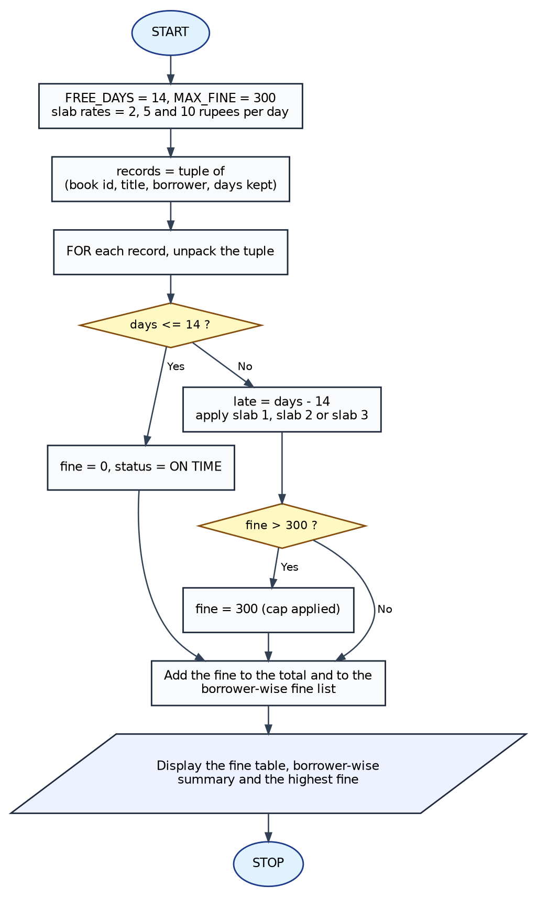
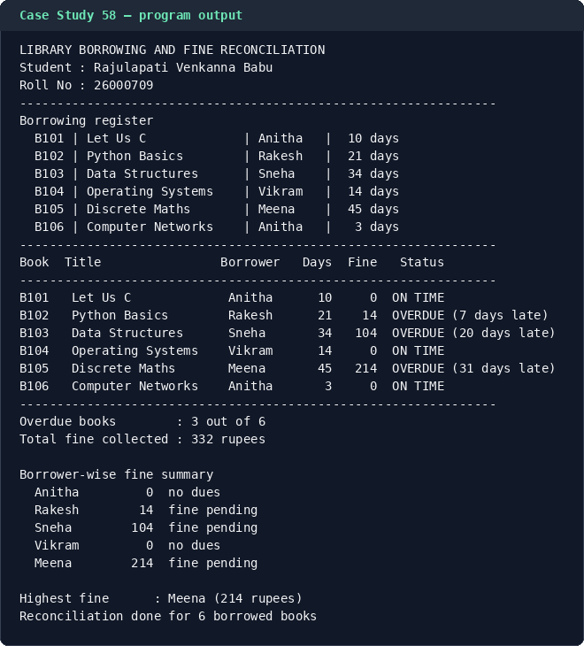

# Case Study 58: Library Borrowing and Fine Reconciliation

**Name:** Rajulapati Venkanna Babu  
**Roll No:** 26000709  
**Section:** Section - 4

---

## Problem Statement

A library lends books for 14 days without any fine. After the due date the fine is calculated in slabs, and the total fine for one book cannot exceed 300 rupees. The borrowing records are stored as tuples containing the book identifier, the title, the borrower and the number of days the book was kept. The program must calculate the fine of every book, list the overdue books, and prepare a borrower-wise summary.

## Objectives

- To store the borrowing records as tuples of four values.
- To apply the free period and the three fine slabs correctly.
- To apply the maximum fine limit of 300 rupees per book.
- To prepare a borrower-wise fine summary using lists.
- To identify the borrower with the highest fine.

## Assumptions

- A book kept for 14 days or less has no fine.
- The fine is 2 rupees per day for the first 7 late days, 5 rupees per day for the next 8 late days and 10 rupees per day after that.
- The fine of a single book is capped at 300 rupees.
- The days kept are counted from the date of issue up to the date of return.
- The borrowing records are already available in the program.

## Algorithm

1. Start the program.
2. Set the free days to 14, the slab rates to 2, 5 and 10 rupees and the maximum fine to 300 rupees.
3. Store the borrowing records as tuples and display the register.
4. Create empty lists for the fine report, the borrower names and the borrower fines.
5. Repeat for every record:
   - Unpack the book identifier, the title, the borrower and the days kept.
   - If the days are within the free period, the fine is zero and the status is on time.
   - Otherwise calculate the late days and apply the first, second or third slab.
   - If the fine is more than 300 rupees, reduce it to 300 and mark the status as overdue.
   - Add the fine to the total and add it to the fine of that borrower in the borrower list.
   - Store a tuple with the book details, the fine and the status in the fine report.
6. Display the fine table by unpacking every tuple.
7. Display the number of overdue books and the total fine collected.
8. Display the borrower-wise fine summary.
9. Find and display the borrower with the highest fine.
10. Stop the program.

## Flowchart



## Pseudocode

```
FREE_DAYS <- 14
FINE_SLAB_1 <- 2
FINE_SLAB_2 <- 5
FINE_SLAB_3 <- 10
MAX_FINE <- 300

records <- (("B101", "Let Us C", "Anitha", 10),
            ("B102", "Python Basics", "Rakesh", 21),
            ("B103", "Data Structures", "Sneha", 34),
            ("B104", "Operating Systems", "Vikram", 14),
            ("B105", "Discrete Maths", "Meena", 45),
            ("B106", "Computer Networks", "Anitha", 3))

total_fine <- 0
overdue_count <- 0
fine_report <- []
borrower_names <- []
borrower_fines <- []

FOR EACH record IN records
    (book_id, title, borrower, days) <- record

    IF days <= FREE_DAYS THEN
        fine <- 0
        status <- "ON TIME"
    ELSE
        late <- days - FREE_DAYS
        IF late <= 7 THEN
            fine <- late * FINE_SLAB_1
        ELSE IF late <= 15 THEN
            fine <- 7 * FINE_SLAB_1 + (late - 7) * FINE_SLAB_2
        ELSE
            fine <- 7 * FINE_SLAB_1 + 8 * FINE_SLAB_2 + (late - 15) * FINE_SLAB_3
        END IF
        IF fine > MAX_FINE THEN fine <- MAX_FINE
        status <- "OVERDUE"
        overdue_count <- overdue_count + 1
    END IF

    total_fine <- total_fine + fine
    APPEND (book_id, title, borrower, days, fine, status) TO fine_report

    IF borrower IN borrower_names THEN
        position <- INDEX_OF(borrower_names, borrower)
        borrower_fines[position] <- borrower_fines[position] + fine
    ELSE
        APPEND borrower TO borrower_names
        APPEND fine TO borrower_fines
    END IF
END FOR

FOR EACH (book_id, title, borrower, days, fine, status) IN fine_report
    DISPLAY book_id, title, borrower, days, fine, status
END FOR

DISPLAY "Overdue books :", overdue_count, "out of", len(records)
DISPLAY "Total fine collected :", total_fine

FOR i <- 0 TO len(borrower_names) - 1
    DISPLAY borrower_names[i], borrower_fines[i]
END FOR

top <- 0
FOR i <- 1 TO len(borrower_names) - 1
    IF borrower_fines[i] > borrower_fines[top] THEN top <- i
END FOR
DISPLAY "Highest fine :", borrower_names[top], borrower_fines[top]
```

## Python Source Code

The complete program is in `solution.py`.

```python
# Case Study 58: Library Borrowing and Fine Reconciliation
# Syllabus used: variables, operators, conditional statements, loops, strings, lists, tuples,
#               tuple operations and unpacking

print("LIBRARY BORROWING AND FINE RECONCILIATION")
print("Student : Rajulapati Venkanna Babu")
print("Roll No : 26000709")
print("-" * 64)

FREE_DAYS = 14          # books may be kept for 14 days without fine
FINE_SLAB_1 = 2         # rupees per day for days 1 to 7 after the due date
FINE_SLAB_2 = 5         # rupees per day for days 8 to 15 after the due date
FINE_SLAB_3 = 10        # rupees per day after that
MAX_FINE = 300          # fine is capped per book

# each record is a tuple: (book id, title, borrower, days kept)
records = (
    ("B101", "Let Us C", "Anitha", 10),
    ("B102", "Python Basics", "Rakesh", 21),
    ("B103", "Data Structures", "Sneha", 34),
    ("B104", "Operating Systems", "Vikram", 14),
    ("B105", "Discrete Maths", "Meena", 45),
    ("B106", "Computer Networks", "Anitha", 3),
)

print("Borrowing register")
for book_id, title, borrower, days in records:          # tuple unpacking
    print("  " + book_id, "|", title.ljust(20), "|", borrower.ljust(8), "|", str(days).rjust(3), "days")
print("-" * 64)

total_fine = 0
overdue_count = 0
fine_report = []
borrower_names = []
borrower_fines = []

for book_id, title, borrower, days in records:
    if days <= FREE_DAYS:
        fine = 0
        status = "ON TIME"
        late = 0
    else:
        late = days - FREE_DAYS
        if late <= 7:
            fine = late * FINE_SLAB_1
        elif late <= 15:
            fine = 7 * FINE_SLAB_1 + (late - 7) * FINE_SLAB_2
        else:
            fine = 7 * FINE_SLAB_1 + 8 * FINE_SLAB_2 + (late - 15) * FINE_SLAB_3

        if fine > MAX_FINE:
            fine = MAX_FINE
        status = "OVERDUE (" + str(late) + " days late)"
        overdue_count = overdue_count + 1

    total_fine = total_fine + fine
    fine_report.append((book_id, title, borrower, days, fine, status))

    if borrower in borrower_names:
        position = borrower_names.index(borrower)
        borrower_fines[position] = borrower_fines[position] + fine
    else:
        borrower_names.append(borrower)
        borrower_fines.append(fine)

print("Book  Title                Borrower   Days  Fine   Status")
print("-" * 64)
for book_id, title, borrower, days, fine, status in fine_report:      # tuple unpacking
    print(book_id.ljust(6), title.ljust(20), borrower.ljust(10),
          str(days).rjust(3), str(fine).rjust(5), " " + status)

print("-" * 64)
print("Overdue books        :", overdue_count, "out of", len(records))
print("Total fine collected :", total_fine, "rupees")

print()
print("Borrower-wise fine summary")
for i in range(len(borrower_names)):
    if borrower_fines[i] > 0:
        remark = "fine pending"
    else:
        remark = "no dues"
    print("  " + borrower_names[i].ljust(10), str(borrower_fines[i]).rjust(5), " " + remark)

# highest fine paying borrower
if len(borrower_names) > 0:
    top = 0
    for i in range(1, len(borrower_names)):
        if borrower_fines[i] > borrower_fines[top]:
            top = i
    print()
    print("Highest fine      :", borrower_names[top], "(" + str(borrower_fines[top]) + " rupees)")
    print("Reconciliation done for", len(records), "borrowed books")
```

## Test Cases

| # | Test case | Input | Expected output |
|---|-----------|-------|-----------------|
| 1 | Book returned within the free period | No input needed | B104 with 14 days shows a fine of 0 and the status ON TIME |
| 2 | First slab fine | No input needed | B102 with 7 late days is charged 14 rupees |
| 3 | Second slab fine | No input needed | B103 with 20 late days is charged 104 rupees |
| 4 | Third slab fine | No input needed | B105 with 31 late days is charged 214 rupees |
| 5 | Totals and highest fine | No input needed | Total fine is 332 rupees, 3 of 6 books are overdue and Meena has the highest fine |

All of these test cases are checked automatically by running `python test_cases.py`.

## Output Screenshot



The same output is saved as plain text in `output.txt`.

## Conclusion

The slab-wise fine calculation matches the library rules and the maximum fine limit is applied to every book. Grouping the fine into borrower-wise lists converts the book-wise records into a summary, which is what the library needs for reconciliation.
