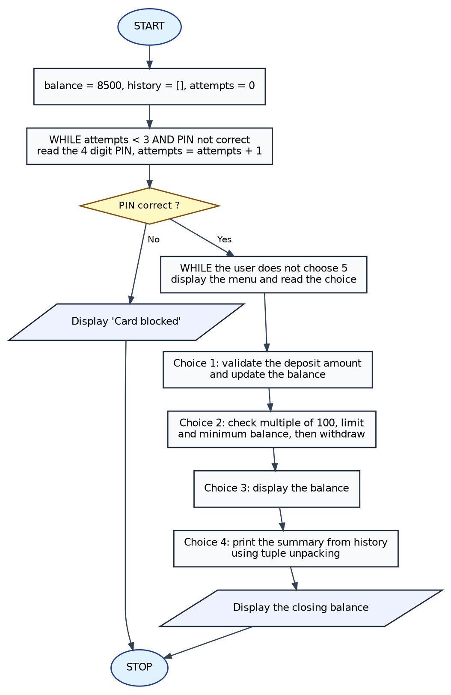
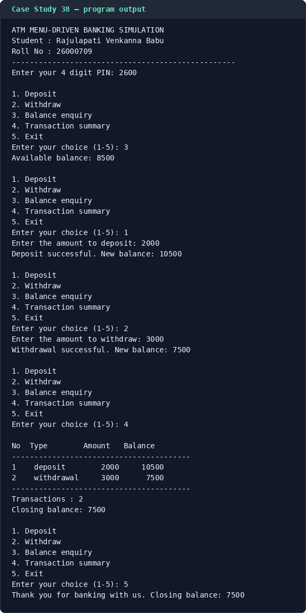

# Case Study 38: ATM Menu-Driven Banking Simulation

**Name:** Rajulapati Venkanna Babu  
**Roll No:** 26000709  
**Section:** Section - 4

---

## Problem Statement

A simple ATM simulation is required. After the correct PIN is entered within three attempts, the user must be able to deposit money, withdraw money, check the balance and see a summary of the transactions of the session. Every operation has to be validated: the amount must be positive, a withdrawal must be a multiple of 100, it cannot cross the per transaction limit, and a minimum balance of 500 rupees must always remain in the account.

## Objectives

- To implement a menu-driven program using a while loop.
- To allow only three PIN attempts before blocking the card.
- To validate every deposit and withdrawal amount.
- To maintain the balance and a list of the transactions of the session.
- To print a transaction summary using tuple unpacking.

## Assumptions

- The account starts with a balance of 8500 rupees and the PIN is 2600.
- The minimum balance to be maintained is 500 rupees.
- A single withdrawal cannot be more than 20000 rupees and a single deposit cannot be more than 50000 rupees.
- Withdrawal amounts must be multiples of 100 rupees.
- Every accepted operation is stored as a tuple (type, amount, balance after the operation).

## Algorithm

1. Start the program.
2. Set the balance, create an empty transaction history, set the attempt counter to zero and the PIN flag to false.
3. While fewer than three attempts have been made and the PIN is not correct:
   - Read the PIN and increase the attempt counter.
   - If the PIN is correct set the PIN flag to true, otherwise print the remaining attempts.
4. If the PIN is still not correct, print that the card is blocked and stop.
5. Otherwise repeat until the user chooses to exit:
   - Display the five menu options and read the choice.
   - For a deposit, check that the amount is positive and within the deposit limit, then update the balance and store the transaction.
   - For a withdrawal, check that the amount is positive, a multiple of 100, within the limit and that the minimum balance will remain, then update the balance and store the transaction.
   - For a balance enquiry, print the balance.
   - For a summary, print every stored transaction by unpacking its tuple.
   - For exit, print the closing balance and end the loop.
   - For any other choice, print an invalid choice message.
6. Stop the program.

## Flowchart



## Pseudocode

```
PIN <- "2600"
MIN_BALANCE <- 500
MAX_WITHDRAWAL <- 20000
MAX_DEPOSIT <- 50000

balance <- 8500
history <- []
attempts <- 0
pin_ok <- FALSE

WHILE attempts < 3 AND pin_ok = FALSE
    READ entered_pin
    attempts <- attempts + 1
    IF entered_pin = PIN THEN
        pin_ok <- TRUE
    ELSE
        DISPLAY "Incorrect PIN. Attempts left:", 3 - attempts
    END IF
END WHILE

IF pin_ok = FALSE THEN
    DISPLAY "Card blocked - three wrong PIN attempts"
ELSE
    running <- TRUE
    WHILE running
        DISPLAY the menu 1 to 5
        READ choice

        IF choice = "1" THEN
            READ amount
            IF amount <= 0 THEN DISPLAY "REJECTED - deposit amount must be positive"
            ELSE IF amount > MAX_DEPOSIT THEN DISPLAY "REJECTED - deposit limit is 50000"
            ELSE
                balance <- balance + amount
                APPEND ("deposit", amount, balance) TO history
                DISPLAY "Deposit successful. New balance:", balance
            END IF

        ELSE IF choice = "2" THEN
            READ amount
            IF amount <= 0 THEN DISPLAY "REJECTED - withdrawal amount must be positive"
            ELSE IF amount % 100 <> 0 THEN DISPLAY "REJECTED - enter the amount in multiples of 100"
            ELSE IF amount > MAX_WITHDRAWAL THEN DISPLAY "REJECTED - per transaction limit is 20000"
            ELSE IF balance - amount < MIN_BALANCE THEN DISPLAY "REJECTED - insufficient balance"
            ELSE
                balance <- balance - amount
                APPEND ("withdrawal", amount, balance) TO history
                DISPLAY "Withdrawal successful. New balance:", balance
            END IF

        ELSE IF choice = "3" THEN
            DISPLAY "Available balance:", balance

        ELSE IF choice = "4" THEN
            IF len(history) = 0 THEN DISPLAY "No transactions performed in this session"
            ELSE
                FOR EACH (txn_type, amount, after) IN history
                    DISPLAY txn_type, amount, after
                END FOR
                DISPLAY "Transactions :", len(history)
            END IF

        ELSE IF choice = "5" THEN
            DISPLAY "Thank you for banking with us. Closing balance:", balance
            running <- FALSE

        ELSE
            DISPLAY "INVALID CHOICE - please enter a number from 1 to 5"
        END IF
    END WHILE
END IF
```

## Python Source Code

The complete program is in `solution.py`.

```python
# Case Study 38: ATM Menu-Driven Banking Simulation
# Syllabus used: variables, operators, conditional statements, loops, strings, lists

PIN = "2600"
MIN_BALANCE = 500          # minimum balance that must stay in the account
MAX_WITHDRAWAL = 20000     # per transaction limit
MAX_DEPOSIT = 50000        # per transaction limit

balance = 8500
history = []               # list of tuples (type, amount, balance after the operation)
attempts = 0
pin_ok = False

print("ATM MENU-DRIVEN BANKING SIMULATION")
print("Student : Rajulapati Venkanna Babu")
print("Roll No : 26000709")
print("-" * 50)

while attempts < 3 and pin_ok == False:
    entered = input("Enter your 4 digit PIN: ")
    attempts = attempts + 1
    if entered == PIN:
        pin_ok = True
    else:
        print("Incorrect PIN. Attempts left:", 3 - attempts)

if pin_ok == False:
    print("Card blocked - three wrong PIN attempts")
else:
    running = True
    while running:
        print()
        print("1. Deposit")
        print("2. Withdraw")
        print("3. Balance enquiry")
        print("4. Transaction summary")
        print("5. Exit")
        choice = input("Enter your choice (1-5): ")

        if choice == "1":
            amount = int(input("Enter the amount to deposit: "))
            if amount <= 0:
                print("REJECTED - deposit amount must be positive")
            elif amount > MAX_DEPOSIT:
                print("REJECTED - deposit limit is", MAX_DEPOSIT)
            else:
                balance = balance + amount
                history.append(("deposit", amount, balance))
                print("Deposit successful. New balance:", balance)

        elif choice == "2":
            amount = int(input("Enter the amount to withdraw: "))
            if amount <= 0:
                print("REJECTED - withdrawal amount must be positive")
            elif amount % 100 != 0:
                print("REJECTED - enter the amount in multiples of 100")
            elif amount > MAX_WITHDRAWAL:
                print("REJECTED - per transaction limit is", MAX_WITHDRAWAL)
            elif balance - amount < MIN_BALANCE:
                print("REJECTED - insufficient balance, minimum balance", MIN_BALANCE, "must be maintained")
            else:
                balance = balance - amount
                history.append(("withdrawal", amount, balance))
                print("Withdrawal successful. New balance:", balance)

        elif choice == "3":
            print("Available balance:", balance)

        elif choice == "4":
            if len(history) == 0:
                print("No transactions performed in this session")
            else:
                print()
                print("No  Type        Amount   Balance")
                print("-" * 40)
                count = 1
                for txn_type, amount, after in history:          # tuple unpacking
                    print(str(count).ljust(4), txn_type.ljust(12), str(amount).rjust(6), str(after).rjust(9))
                    count = count + 1
                print("-" * 40)
                print("Transactions :", len(history))
                print("Closing balance:", balance)

        elif choice == "5":
            print("Thank you for banking with us. Closing balance:", balance)
            running = False

        else:
            print("INVALID CHOICE - please enter a number from 1 to 5")
```

## Test Cases

| # | Test case | Input | Expected output |
|---|-----------|-------|-----------------|
| 1 | Successful deposit and withdrawal | 2600, 1, 2000, 2, 3000, 4, 5 | Balance changes from 8500 to 10500 and then to 7500, and the summary shows both entries |
| 2 | Withdrawal not a multiple of 100 | 2600, 2, 250, 5 | REJECTED - enter the amount in multiples of 100 |
| 3 | Withdrawal above the limit | 2600, 2, 50000, 5 | REJECTED - per transaction limit is 20000 |
| 4 | Minimum balance protection | 2600, 2, 8100, 5 | REJECTED - insufficient balance, minimum balance 500 must be maintained |
| 5 | Invalid menu choice | 2600, 9, 5 | INVALID CHOICE - please enter a number from 1 to 5 |
| 6 | Three wrong PIN attempts | 1111, 2222, 3333 | Card blocked - three wrong PIN attempts |

All of these test cases are checked automatically by running `python test_cases.py`.

## Output Screenshot



The same output is saved as plain text in `output.txt`.

## Conclusion

The menu-driven loop keeps the ATM running until the user exits and every operation is validated before the balance is changed. The minimum balance, the withdrawal limit and the multiple of 100 rule are all enforced, so an invalid transaction can never make the balance wrong.
