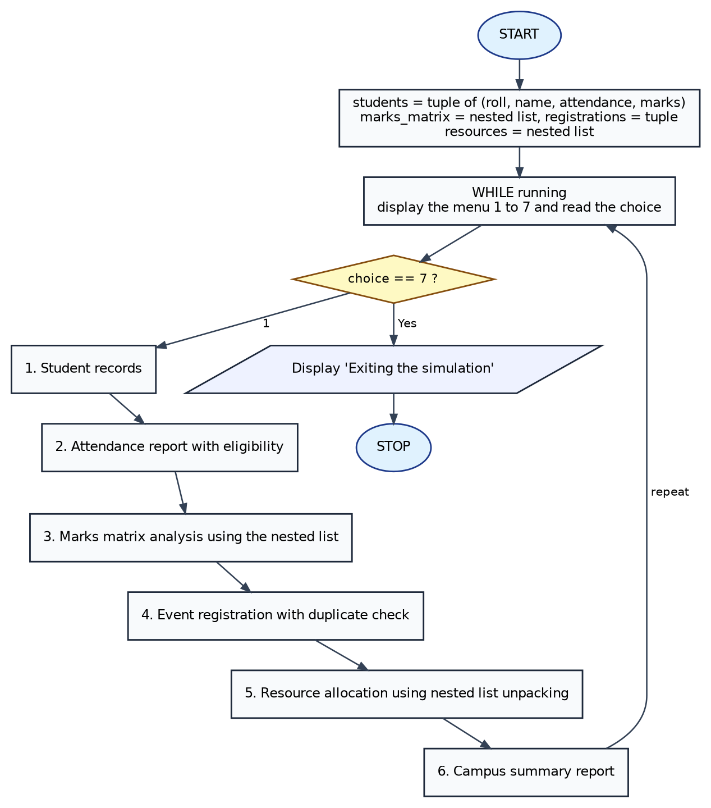
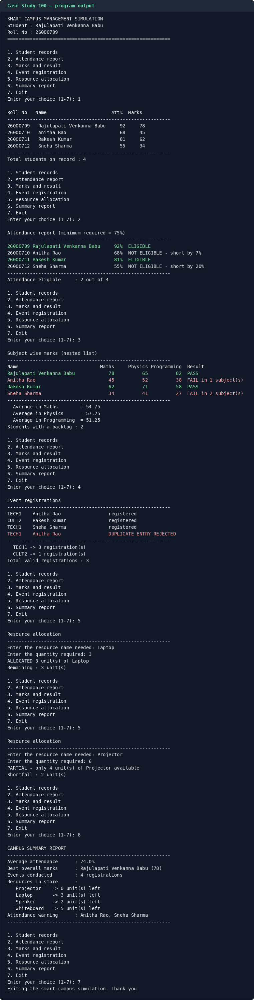

# Case Study 100: Comprehensive Smart Campus Management Simulation

**Name:** Rajulapati Venkanna Babu  
**Roll No:** 26000709  
**Section:** Section - 4

---

## Problem Statement

A college wants one small program that brings together student records, attendance, subject marks, event registrations and campus resources. The records must be kept in tuples and nested lists, and the program must run as a menu so that the user can choose any report. It has to show the student records, prepare an attendance report with an eligibility check, analyse the marks matrix, validate event registrations against duplicate entries, allocate campus resources, and finally print a summary report of the whole campus.

## Objectives

- To combine conditional statements, loops, strings, lists, nested lists, tuples and tuple unpacking in one program.
- To keep the student records in tuples and the subject marks in a nested list.
- To prepare an attendance report with a minimum attendance rule.
- To analyse the marks matrix row-wise and subject-wise.
- To validate event registrations and detect duplicate entries.
- To allocate campus resources and report shortages.
- To print a summary report of the campus.

## Assumptions

- The minimum attendance required for eligibility is 75 percent and the pass mark is 40.
- Every student has marks in the same three subjects and in the same order as the subject list.
- The same student cannot register twice for the same event.
- A resource request bigger than the available quantity is fulfilled partially and the shortfall is reported.
- All the data is already available in the program and only the menu choice is given by the user.

## Algorithm

1. Start the program.
2. Store the student records as tuples of roll number, name, attendance and marks.
3. Store the subject names in a list and the subject-wise marks in a nested list.
4. Store the event registrations as tuples and the resources as a nested list of name and quantity.
5. Set the running flag to true.
6. While the program is running, display the menu 1 to 7 and read the choice.
7. For choice 1, unpack every student tuple and print the student records.
8. For choice 2, check the attendance of every student against 75 percent, print the shortfall and count the eligible students.
9. For choice 3, traverse the nested marks list row-wise with an inner loop, print the result of every student, then traverse it column-wise and print the subject averages.
10. For choice 4, read the event tuples, keep the accepted names in a list and reject a duplicate entry, then count the registrations of every event.
11. For choice 5, read the resource name and quantity, search the nested resource list, allocate the quantity, report the remaining quantity or the shortfall, and stop searching once the resource is found.
12. For choice 6, calculate the average attendance, find the best student, count the registrations, print the remaining resources and list the students with low attendance.
13. For choice 7, print the exit message and set the running flag to false.
14. For any other value, print an invalid choice message.
15. Stop the program.

## Flowchart



## Pseudocode

```
students <- (("26000709", "Rajulapati Venkanna Babu", 92, 78),
             ("26000710", "Anitha Rao", 68, 45),
             ("26000711", "Rakesh Kumar", 81, 62),
             ("26000712", "Sneha Sharma", 55, 34))
subjects <- ["Maths", "Physics", "Programming"]
marks_matrix <- [[78, 65, 82], [45, 52, 38], [62, 71, 58], [34, 41, 27]]
registrations <- (("TECH1", "Anitha Rao"), ("CULT2", "Rakesh Kumar"),
                  ("TECH1", "Sneha Sharma"), ("TECH1", "Anitha Rao"))
resources <- [["Projector", 4], ["Laptop", 6], ["Speaker", 2], ["Whiteboard", 5]]
MIN_ATTENDANCE <- 75
PASS_MARK <- 40

running <- TRUE
WHILE running
    DISPLAY the menu 1 to 7
    READ choice

    IF choice = "1" THEN
        FOR EACH (roll_no, name, attendance, marks) IN students
            DISPLAY roll_no, name, attendance, marks
        END FOR

    ELSE IF choice = "2" THEN
        eligible_count <- 0
        FOR EACH (roll_no, name, attendance, marks) IN students
            IF attendance >= MIN_ATTENDANCE THEN
                DISPLAY "ELIGIBLE"
                eligible_count <- eligible_count + 1
            ELSE
                DISPLAY "NOT ELIGIBLE - short by", MIN_ATTENDANCE - attendance
            END IF
        END FOR

    ELSE IF choice = "3" THEN
        FOR i <- 0 TO len(students) - 1
            row <- marks_matrix[i]
            failed <- 0
            FOR j <- 0 TO len(row) - 1
                IF row[j] < PASS_MARK THEN failed <- failed + 1
            END FOR
            DISPLAY students[i][1], row, the result
        END FOR
        FOR j <- 0 TO len(subjects) - 1
            total <- 0
            FOR i <- 0 TO len(marks_matrix) - 1
                total <- total + marks_matrix[i][j]
            END FOR
            DISPLAY "Average in", subjects[j], ROUND(total / len(marks_matrix), 2)
        END FOR

    ELSE IF choice = "4" THEN
        seen <- []
        FOR EACH (event_code, name) IN registrations
            IF name IN seen THEN
                DISPLAY event_code, name, "DUPLICATE ENTRY REJECTED"
            ELSE
                APPEND name TO seen
                DISPLAY event_code, name, "registered"
            END IF
        END FOR

    ELSE IF choice = "5" THEN
        READ request, quantity
        found <- FALSE
        index <- 0
        WHILE index < len(resources)
            (resource_name, available) <- resources[index]
            IF resource_name = request THEN
                found <- TRUE
                IF quantity > available THEN
                    DISPLAY "PARTIAL - only", available, "available"
                    resources[index][1] <- 0
                ELSE
                    resources[index][1] <- available - quantity
                    DISPLAY "ALLOCATED", quantity, "remaining", resources[index][1]
                END IF
                BREAK
            END IF
            index <- index + 1
        END WHILE
        IF found = FALSE THEN DISPLAY "INVALID - not a campus resource"

    ELSE IF choice = "6" THEN
        compute the average attendance, the best student, the number of
        registrations, the remaining resources and the low attendance list
        DISPLAY the summary report

    ELSE IF choice = "7" THEN
        DISPLAY "Exiting the smart campus simulation. Thank you."
        running <- FALSE

    ELSE
        DISPLAY "INVALID CHOICE - please enter a number from 1 to 7"
    END IF
END WHILE
```

## Python Source Code

The complete program is in `solution.py`.

```python
# Case Study 100: Comprehensive Smart Campus Management Simulation
# Syllabus used: conditional statements, loops, strings, lists, nested lists, tuples and tuple unpacking

# ---------------------------------------------------------------
# DATA
# ---------------------------------------------------------------
# student records stored as tuples: (roll no, name, attendance %, marks)
students = (
    ("26000709", "Rajulapati Venkanna Babu", 92, 78),
    ("26000710", "Anitha Rao", 68, 45),
    ("26000711", "Rakesh Kumar", 81, 62),
    ("26000712", "Sneha Sharma", 55, 34),
)

subjects = ["Maths", "Physics", "Programming"]

# nested list - subject wise marks of every student, in the same order as "students"
marks_matrix = [
    [78, 65, 82],
    [45, 52, 38],
    [62, 71, 58],
    [34, 41, 27],
]

# event registrations stored as tuples: (event code, student name)
registrations = (
    ("TECH1", "Anitha Rao"),
    ("CULT2", "Rakesh Kumar"),
    ("TECH1", "Sneha Sharma"),
    ("TECH1", "Anitha Rao"),
)

# nested list - resource name and its available quantity
resources = [
    ["Projector", 4],
    ["Laptop", 6],
    ["Speaker", 2],
    ["Whiteboard", 5],
]

MIN_ATTENDANCE = 75
PASS_MARK = 40

print("SMART CAMPUS MANAGEMENT SIMULATION")
print("Student : Rajulapati Venkanna Babu")
print("Roll No : 26000709")
print("=" * 58)

running = True
while running:
    print()
    print("1. Student records")
    print("2. Attendance report")
    print("3. Marks and result")
    print("4. Event registration")
    print("5. Resource allocation")
    print("6. Summary report")
    print("7. Exit")
    choice = input("Enter your choice (1-7): ")

    if choice == "1":
        print()
        print("Roll No   Name                       Att%  Marks")
        print("-" * 58)
        for roll_no, name, attendance, marks in students:          # tuple unpacking
            print(roll_no.ljust(10), name.ljust(26), str(attendance).rjust(4), str(marks).rjust(6))
        print("-" * 58)
        print("Total students on record :", len(students))

    elif choice == "2":
        print()
        print("Attendance report (minimum required = " + str(MIN_ATTENDANCE) + "%)")
        print("-" * 58)
        eligible_count = 0
        for roll_no, name, attendance, marks in students:
            shortfall = MIN_ATTENDANCE - attendance
            if attendance >= MIN_ATTENDANCE:
                status = "ELIGIBLE"
                eligible_count = eligible_count + 1
            else:
                status = "NOT ELIGIBLE - short by " + str(shortfall) + "%"
            print(roll_no, name.ljust(26), str(attendance).rjust(4) + "% ", status)
        print("-" * 58)
        print("Attendance eligible     :", eligible_count, "out of", len(students))

    elif choice == "3":
        print()
        print("Subject wise marks (nested list)")
        print("-" * 58)
        header = "Name".ljust(26)
        for subject in subjects:
            header = header + subject.rjust(12)
        header = header + "  Result"
        print(header)
        failed_total = 0
        for i in range(len(students)):
            row = marks_matrix[i]
            line = students[i][1].ljust(26)
            failed = 0
            for j in range(len(row)):
                line = line + str(row[j]).rjust(12)
                if row[j] < PASS_MARK:
                    failed = failed + 1
            if failed == 0:
                result = "PASS"
            else:
                result = "FAIL in " + str(failed) + " subject(s)"
                failed_total = failed_total + 1
            print(line, " " + result)
        print("-" * 58)

        # subject wise average using the nested list
        for j in range(len(subjects)):
            total = 0
            for i in range(len(marks_matrix)):
                total = total + marks_matrix[i][j]
            print("  Average in", subjects[j].ljust(12), "=", round(total / len(marks_matrix), 2))
        print("Students with a backlog :", failed_total)

    elif choice == "4":
        print()
        print("Event registrations")
        print("-" * 58)
        seen = []
        for event_code, name in registrations:          # tuple unpacking
            if name in seen:
                print(event_code.ljust(8), name.ljust(26), "DUPLICATE ENTRY REJECTED")
            else:
                seen.append(name)
                print(event_code.ljust(8), name.ljust(26), "registered")

        # event wise count
        print("-" * 58)
        checked = []
        for event_code, name in registrations:
            if event_code not in checked:
                checked.append(event_code)
                count = 0
                for code, other_name in registrations:
                    if code == event_code:
                        count = count + 1
                print("  " + event_code, "->", count, "registration(s)")
        print("Total valid registrations :", len(seen))

    elif choice == "5":
        print()
        print("Resource allocation")
        print("-" * 58)
        request = input("Enter the resource name needed: ")
        quantity = int(input("Enter the quantity required: "))

        found = False
        index = 0
        while index < len(resources):
            resource_name, available = resources[index]        # nested list unpacking
            if resource_name == request:
                found = True
                if quantity <= 0:
                    print("REJECTED - quantity must be greater than zero")
                elif quantity > available:
                    print("PARTIAL - only", available, "unit(s) of", resource_name, "available")
                    print("Shortfall :", quantity - available, "unit(s)")
                    resources[index][1] = 0
                else:
                    resources[index][1] = available - quantity
                    print("ALLOCATED", quantity, "unit(s) of", resource_name)
                    print("Remaining :", resources[index][1], "unit(s)")
                break
            index = index + 1

        if found == False:
            print("INVALID - '" + request + "' is not a campus resource")
            print("Available resources :", end=" ")
            for item in resources:
                print(item[0], end=" ")
            print()

    elif choice == "6":
        print()
        print("CAMPUS SUMMARY REPORT")
        print("-" * 58)
        attendance_total = 0
        for roll_no, name, attendance, marks in students:
            attendance_total = attendance_total + attendance
        print("Average attendance      :", str(round(attendance_total / len(students), 2)) + "%")

        best_index = 0
        for i in range(1, len(students)):
            if students[i][3] > students[best_index][3]:
                best_index = i
        print("Best overall marks      :", students[best_index][1], "(" + str(students[best_index][3]) + ")")

        print("Events conducted        :", len(registrations), "registrations")
        print("Resources in store      :")
        for item in resources:
            print("   " + item[0].ljust(12), "->", item[1], "unit(s) left")

        low_attendance = ""
        for roll_no, name, attendance, marks in students:
            if attendance < MIN_ATTENDANCE:
                if low_attendance != "":
                    low_attendance = low_attendance + ", "
                low_attendance = low_attendance + name
        if low_attendance != "":
            print("Attendance warning      :", low_attendance)
        print("-" * 58)

    elif choice == "7":
        print("Exiting the smart campus simulation. Thank you.")
        running = False

    else:
        print("INVALID CHOICE - please enter a number from 1 to 7")
```

## Test Cases

| # | Test case | Input | Expected output |
|---|-----------|-------|-----------------|
| 1 | Student records | 1, 7 | All four students are printed with attendance and marks |
| 2 | Attendance eligibility | 2, 7 | Two students are ELIGIBLE and the others show the attendance shortfall |
| 3 | Marks matrix analysis | 3, 7 | Student results, subject averages 54.75, 57.25 and 51.25 and 2 students with a backlog |
| 4 | Duplicate event registration | 4, 7 | The second TECH1 entry of Anitha Rao is rejected and 3 valid registrations remain |
| 5 | Resource allocation | 5, Laptop, 3, 7 | ALLOCATED 3 unit(s) of Laptop with 3 units remaining |
| 6 | Partial resource allocation | 5, Projector, 6, 7 | PARTIAL - only 4 unit(s) available with a shortfall of 2 |
| 7 | Unknown resource | 5, Chair, 2, 7 | INVALID - 'Chair' is not a campus resource |
| 8 | Summary report | 6, 7 | Average attendance 74.0%, best student, resource list and the attendance warning |
| 9 | Invalid menu choice | 9, 7 | INVALID CHOICE - please enter a number from 1 to 7 |

All of these test cases are checked automatically by running `python test_cases.py`.

## Output Screenshot



The same output is saved as plain text in `output.txt`.

## Conclusion

This simulation brings together every topic of the syllabus in one program. The student records use tuples, the marks use a nested list, the registrations use tuple unpacking, and the menu keeps running through a while loop with conditional statements. Each module gives the required output, so the program works like a small campus application rather than ten separate exercises.
